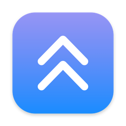
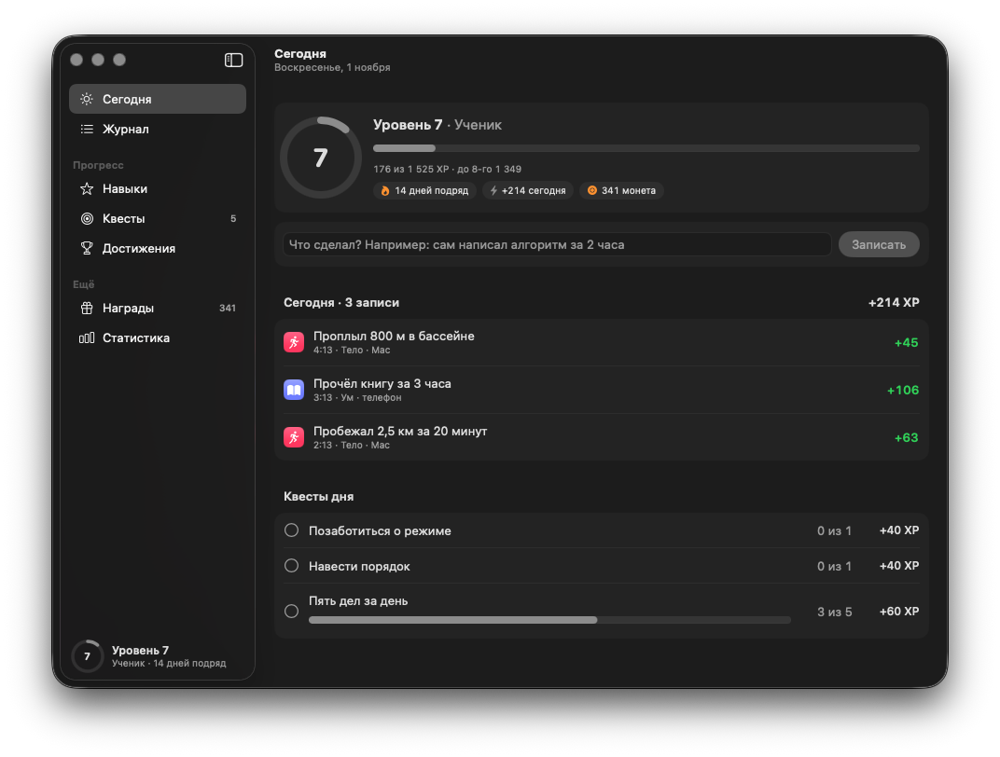
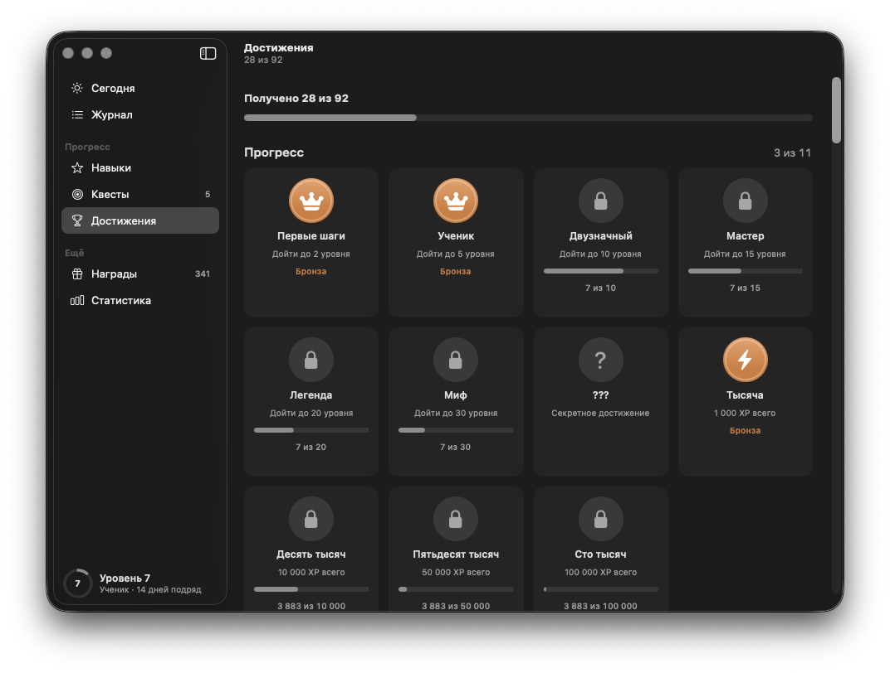
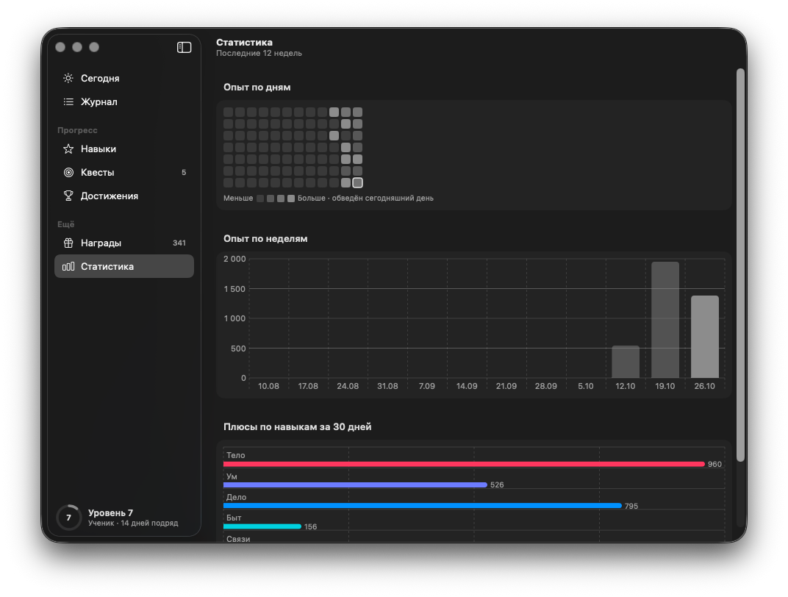
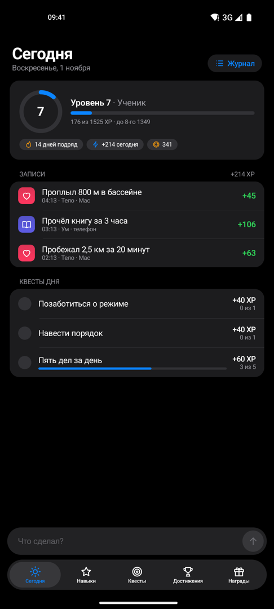
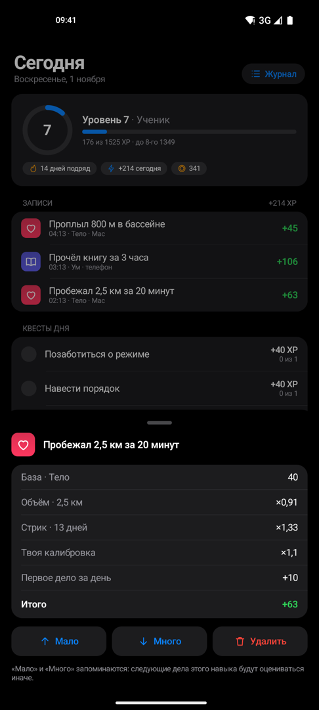
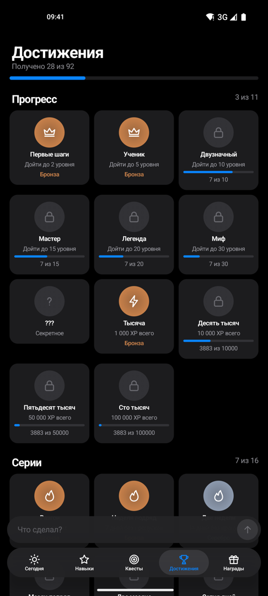

<div align="center">



# Прокачка

**Опыт за каждое дело. Пишешь, что сделал, — приложение само решает, сколько XP дать и за что.**

[](https://github.com/Arti-Ko/prokachka/releases/latest)
[](https://github.com/Arti-Ko/prokachka/actions/workflows/ci.yml)


[**⬇ Скачать для Mac**](https://github.com/Arti-Ko/prokachka/releases/latest/download/Prokachka.dmg) · [**⬇ Скачать для Android**](https://github.com/Arti-Ko/prokachka/releases/latest/download/Prokachka.apk) · [Все выпуски](https://github.com/Arti-Ko/prokachka/releases)



</div>

## Как это работает

1. Пишешь обычными словами: «сам написал алгоритм за 2 часа», «пробежал пять километров», «проспал до обеда».
2. Пока печатаешь, видно оценку: навык, опыт и из чего он сложился — объём, «сам», стрик, повтор.
3. Опыт растит общий уровень и семь навыков: Тело, Ум, Дело, Быт, Связи, Творчество, Режим.

Не согласен с оценкой — нажми на запись и скажи «мало» или «много». Приложение запомнит твою шкалу
для этого навыка и дальше будет оценивать иначе.

## Что умеет

### Формула, которую можно проверить

Опыт = База × Объём × Сам/с помощью × Рекорд/сложность × Интенсивность × Стрик × Разнообразие ×
Повтор × Калибровка × Усталость + Бонусы.

- **Объём** считается под корнем, и у каждого навыка своя норма. Работа — 60 минут, медитация — 15, сон — 8 часов.
  Бег — 3 км, велосипед — 10, плавание — 1.
- **Понимает обычную речь:** «пять километров», «полтора часа», «1ч30м», «3 подхода по 20», «800 м в бассейне».
- **Стрик** даёт +3% за каждый день подряд до 10 дней, дальше +1% до +50% на 30-й день.
- **Разнообразие** поощряется ×1,2 за новый навык или тот, что не качал три дня и дольше.
  После паузы первое дело приносит «С возвращением» +20.
- **Накрутка не работает.** Тот же навык во второй раз за день стоит ×0,85, то же самое дело — ×0,5.
  Больше 500 XP за день — ×0,75, больше 800 — ×0,5.
- **Минусы.** Проспал, залип в ленте, сорвался — опыт уходит, но уровень никогда не падает.
  Повторный минус за день дороже. «Не пошёл в зал» — минус «Телу».
- **Планы не считаются.** «Завтра пойду в зал» опыт не получает — запиши, когда сделаешь.

### Квесты и достижения



- **Квесты дня и недели** подбираются под навыки, которые отстают. Награда начисляется сама.
- **92 достижения** в семи группах: Прогресс, Серии, Дела, Навыки, Объём, Характер, Квесты и награды.
  Четыре уровня редкости — бронза, серебро, золото, платина — и секретные, которые видно, только когда получишь.
- **Монеты** — 10% от каждого плюса. Их можно тратить на награды, которые назначаешь себе сам: серия сериала,
  кофе, выходной без планов.

### Статистика



Карта по дням, опыт по неделям и разбивка плюсов по навыкам за последний месяц.

### Mac

- Окно в раскладке Системных настроек: Сегодня, Журнал, Навыки, Квесты, Достижения, Награды, Статистика.
- **Строка меню:** виден уровень, есть быстрая запись и последние дела.
- **⌥ Пробел** — панель записи поверх любого приложения, как Spotlight.
- Если закрыть окно, приложение остаётся в строке меню.

### Android

<p align="center">
  
  &nbsp;
  
  &nbsp;
  
</p>

- Те же разделы в языке Apple: крупные заголовки, сгруппированные списки, плавающая панель вкладок.
- Поле «Что сделал?» над вкладками, оценка видна до отправки.
- Нажми на запись — разбор оценки и кнопки «Мало», «Много», «Удалить».
- Плитка «Записать дело» в шторке быстрых настроек.

## Установка

**Mac**

1. Скачайте [Prokachka.dmg](https://github.com/Arti-Ko/prokachka/releases/latest/download/Prokachka.dmg), откройте и перетащите «Прокачку» в «Программы».
2. Приложение не заверено у Apple, поэтому при первом запуске macOS его остановит:
   **Системные настройки → Конфиденциальность и безопасность → «Всё равно открыть»**.
   Или в Терминале: `xattr -dr com.apple.quarantine "/Applications/Прокачка.app"`.

**Android**

1. Скачайте [Prokachka.apk](https://github.com/Arti-Ko/prokachka/releases/latest/download/Prokachka.apk) на телефон и откройте. Если Android спросит, разрешите установку из этого источника.
2. Чтобы записывать из шторки: шторка → «Изменить» → перетащите плитку «Записать дело».

Нужны macOS 14 и новее, Android 8 и новее.

## Данные и приватность

Всё хранится на устройстве: на Mac — в `~/Library/Application Support/Prokachka/`, на Android — в папке приложения.
Приложение не ходит в интернет и ничего никуда не отправляет.

Данные — это журнал `events.jsonl`, который только дописывается: дело, правка оценки, удаление, покупка
награды — отдельные события. Уровень, навыки, стрик, квесты и достижения каждый раз вычисляются из журнала.
Формат одинаковый на Mac и Android: синхронизация устройств будет просто объединять журналы, без конфликтов.

## Разработка

| Папка | Что внутри |
|---|---|
| `spec/reference/engine.mjs` | Эталон формулы — источник правды для обеих платформ |
| `spec/reference/achievements.mjs` | Каталог достижений |
| `spec/vectors/` | Общие тесты: 686 фраз в 8 ситуациях, кривая уровней, журнал за три недели с итогами |
| `mac/` | Приложение для Mac: SwiftUI, SwiftPM |
| `android/` | Приложение для Android: Kotlin, Jetpack Compose |
| `design/prototype.html` | Интерактивный макет, с которого всё началось |

```sh
# Mac
cd mac
swift test                    # формула, журнал, сверка с эталоном
Scripts/build.sh              # dist/Prokachka.app
Scripts/build.sh --install    # сразу в /Applications
Scripts/package.sh            # dist/Prokachka.dmg и .zip

# Android
cd android
./gradlew :app:testDebugUnitTest   # те же векторы и тот же журнал, что у Mac
./gradlew :app:assembleDebug       # app/build/outputs/apk/debug/app-debug.apk
```

Mac и Android обязаны считать одинаково до единицы. Обе платформы проходят одни и те же тест-векторы, а журнал
за три недели с правками, удалениями и квестами должен давать одинаковые уровень, монеты и счётчики достижений.

Изменить формулу или достижения:

```sh
node spec/reference/gen-code.mjs      # словарь и каталог → Rules.swift, Rules.kt, AchievementCatalog.*
node spec/reference/gen-vectors.mjs   # тест-векторы
cd mac && UPDATE_SPEC=1 swift test --filter GoldenLedgerTests   # если менялся журнал или достижения
```

Если поменялась сама арифметика, повторите её в `Assessor.swift` и `Assessor.kt`, пока обе платформы не позеленеют.

Выпуск: `Scripts/release.sh 0.2.0`. Тег запускает GitHub Actions, и они публикуют DMG и APK.
